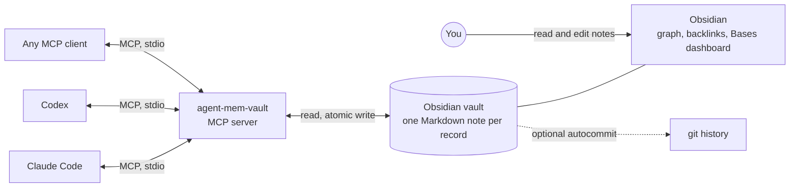

<p align="center">
  
</p>

<p align="center">
  <a href="https://github.com/kursatdinc/agent-mem-vault/actions/workflows/ci.yml"></a>
  <a href="https://pypi.org/project/agent-mem-vault/"></a>
  
  <a href="https://github.com/kursatdinc/agent-mem-vault/blob/main/LICENSE"></a>
  <a href="https://github.com/kursatdinc/agent-mem-vault/wiki"></a>
</p>

**Memory your coding agents share, and you can read, link and fix in Obsidian.**

agent-mem-vault is an [MCP](https://modelcontextprotocol.io) server that turns an
[Obsidian](https://obsidian.md) vault into the long-term memory of your coding agents. Claude Code,
Codex and any other MCP client record decisions, risks, handoffs and project snapshots as notes in
the vault. They read them back in the next session, in the next tool, on the next day. You see
the same memory in Obsidian, and you can correct it there.



## Try it in 60 seconds

The repository ships a demo vault with synthetic records for two fictional projects: decisions
with a supersedes chain, a rejected idea, an open risk, pending and superseded handoffs, snapshots,
hub notes and the dashboard. You need [uv](https://docs.astral.sh/uv/) and, to see the graph,
[Obsidian](https://obsidian.md).

```sh
git clone https://github.com/kursatdinc/agent-mem-vault && cd agent-mem-vault
export AGENT_MEM_VAULT_VAULT="$PWD/examples/demo-vault"

uv run agent-mem-vault doctor                                    # 14 records, 0 issues
uv run agent-mem-vault handoffs --namespace project/harbor-api --status pending
uv run agent-mem-vault search "backfill" --namespace project/harbor-api
```

Then in Obsidian choose *Open folder as vault* and pick `examples/demo-vault`. Open the graph
view to see the decision chain, and `_dashboards/memory.base` for pending handoffs and open
decisions and risks. Edit a note, run `doctor` again, and the change is picked up.

## Install

You need [uv](https://docs.astral.sh/uv/) and an Obsidian vault (create one in Obsidian, for example
`~/agent-memory`; running `git init` inside it is optional).

Claude Code:

```sh
claude mcp add agent-mem-vault -s user \
  --env AGENT_MEM_VAULT_VAULT="$HOME/agent-memory" \
  -- uvx agent-mem-vault
```

Codex (`~/.codex/config.toml`):

```toml
[mcp_servers.agent-mem-vault]
command = "uvx"
args = ["agent-mem-vault"]
env = { AGENT_MEM_VAULT_VAULT = "/Users/you/agent-memory" }
```

Check the setup:

```sh
AGENT_MEM_VAULT_VAULT="$HOME/agent-memory" uvx agent-mem-vault doctor
```

To run the development version straight from GitHub, replace `uvx agent-mem-vault` with
`uvx --from git+https://github.com/kursatdinc/agent-mem-vault agent-mem-vault`.

Then ask your agent to "record this decision", "leave a handoff for Codex" or "what are the open
risks in this project?". It uses the tools below. More snippets are in [examples/](https://github.com/kursatdinc/agent-mem-vault/blob/main/examples).

## Why

- **Agents forget.** Every new session starts cold, and the reasoning behind yesterday's choice
  is gone.
- **Agents don't talk to each other.** What Claude Code decided is invisible to Codex, and the
  other way round.
- **Agent memory is a black box.** It hides in JSON files or databases you can't read, review or
  fix. A wrong "memory" quietly steers every later session.

## What you get

**One memory for all your agents.**
- Claude Code and Codex read and write the same records.
- A handoff left by one agent is picked up by the next, with a real lifecycle: pending, read,
  acknowledged.
- A new handoff can supersede older ones, so the queue holds one live thread instead of a
  growing pile.

**Memory you can see.**
- Every record is a note in your vault.
- Obsidian's graph shows how decisions supersede each other and which records belong to which
  project.
- A generated Bases dashboard lists pending handoffs, open decisions and risks.

**Memory you can correct.**
- Edit a note in Obsidian and the next query sees it.
- Mark a decision rejected, with a reason, and it stops steering agents but stays on record.
- Mark a record private and it stays out of automatic context.

**Typed, not a transcript dump.** Records are `decision`, `risk`, `handoff`, `snapshot`, `note`,
`assumption` and `task`, plus optional `receipt`. Agents can therefore ask precise questions:
"open risks in this project", "what did we decide about caching", "what is waiting for me".

**Yours.** Memory is plain Markdown in a folder you own. Put the vault in git and you get a full
audit trail for free. Everything works offline, and Obsidian does not need to be open.

## How it compares

| | agent-mem-vault | Obsidian-plugin MCP servers (for example [obsidian-local-rest-api](https://github.com/coddingtonbear/obsidian-local-rest-api)) | Embedding-based memory (for example [mem0](https://github.com/mem0ai/mem0)) |
|---|---|---|---|
| Where memory lives | One Markdown note per record in your vault | Your vault, served by a plugin | Memory service built on an LLM and an embedding model |
| Obsidian has to be running | No | Yes: the server runs inside Obsidian | Not applicable |
| Needs an LLM or embedding API key | No | No | Yes, per its README (OpenAI models by default) |
| Readable and editable as notes, with graph and backlinks | Yes, in Obsidian | Yes | Not stored as notes |
| Memory-specific schema: kinds, supersedes, handoff lifecycle | Yes | No: general vault access | Memories |
| Hand edits are protected by revision checks | Yes | Not applicable | Not applicable |

Notes: the other columns summarize each project's public README; check their docs for current
behavior. The Obsidian-plugin servers offer broader vault access (live metadata, the active file,
the command palette) than this project, which is narrowly a memory store. Embedding services find
related memories by meaning, while this project matches stemmed keywords in titles, content and tags.

## Tools

| Group | Tools |
|---|---|
| Write | `save_memory`, `save_context`, `create_snapshot`, `update_memory` |
| Handoffs | `create_handoff`, `read_handoff`, `peek_handoff`, `ack_handoff`, `reopen_handoff`, `list_handoffs` |
| Read | `get_project_brief`, `search_memory`, `list_contexts`, `read_latest_context`, `get_links` |
| Health | `list_issues` |
| Optional | `write_receipt` (receipts), `get_companion`, `update_companion` (companion) |

- Records are grouped by namespace, usually `project/<repo>`.
- Free-text search is stemmed, so "caching" finds "cache" and "cached".
- Memory content is written in English.

Every parameter is documented in the
[tools reference](https://github.com/kursatdinc/agent-mem-vault/wiki/Tools-Reference).

## How it looks

```text
agent-memory/                         # your Obsidian vault
├── project-harbor-api/
│   ├── project-harbor-api.md         # generated hub: every record of the project
│   ├── decision/2026-03-06-move-order-storage-to-postgresql-234bc139.md
│   ├── risk/2026-03-08-migration-script-locks-the-orders-table-728f9c30.md
│   └── handoff/2026-03-10-handoff-to-codex-3ea7ecc4.md
├── project-lantern-mobile/
│   └── ...
└── _dashboards/memory.base           # pending handoffs, decisions and risks, all records
```

```markdown
---
id: 234bc139-823f-5c1c-b7bb-d37ea1c3ee3c
kind: decision
namespace: project/harbor-api
agent: claude-code
title: Move order storage to PostgreSQL
created: 2026-03-06T09:01:00Z
updated: 2026-03-08T09:02:00Z
revision: 2
visibility: internal
validity: valid
tags: [storage]
status: accepted
supersedes: ['[[project-harbor-api/decision/2026-03-02-use-sqlite-for-the-first-release-d61740a1]]']
superseded_by: '[[project-harbor-api/decision/2026-03-08-pin-postgresql-16-in-ci-and-production-eb0b3836]]'
agent-written: true
---
The pilot grew to three workers, which SQLite cannot serve safely. PostgreSQL gives concurrent writers and point-in-time recovery.

<!-- avm:related:start -->
## Related
- Supersedes [[project-harbor-api/decision/2026-03-02-use-sqlite-for-the-first-release-d61740a1|Use SQLite for the first release]]
- Superseded by [[project-harbor-api/decision/2026-03-08-pin-postgresql-16-in-ci-and-production-eb0b3836|Pin PostgreSQL 16 in CI and production]]
<!-- avm:related:end -->
```

## Configuration

`~/.config/agent-mem-vault/config.yaml`. Every key is optional, and environment variables win.
A copy with comments is in [examples/config.yaml](https://github.com/kursatdinc/agent-mem-vault/blob/main/examples/config.yaml).

```yaml
vault: ~/agent-memory              # or AGENT_MEM_VAULT_VAULT
default_namespace: default         # or AGENT_MEM_VAULT_DEFAULT_NAMESPACE
redact_secrets: true               # or AGENT_MEM_VAULT_REDACT_SECRETS
features:
  visibility: true                 # private records stay out of automatic context
  receipts: false                  # immutable records of finished work, with file/commit refs
  companion: false                 # per-project "last session" and "open threads" cards
  hooks: false                     # session-start brief and stop nudge for Claude Code / Codex
  git_autocommit: false            # commit every change in the vault's git repo (never pushes)
companion:
  max_chars: 3000
```

With `hooks` on, `agent-mem-vault hook print-config --client claude|codex` prints the snippet
to add to your client settings. The hook command must be on your `PATH`: run
`uv tool install agent-mem-vault` once. The server never edits client settings itself.

## Guarantees

- **No lost writes.** Two agents writing at once are serialized by a file lock, and every file is
  replaced atomically.
- **No silent overwrites.** Updates check the record's revision. A note you edited by hand is
  never overwritten; the agent gets a conflict and re-reads.
- **Broken notes are reported, not dropped.** A note with invalid frontmatter shows up in
  `list_issues` and `doctor`, untouched.
- **Hands off your setup.** It never writes `.obsidian/`, never launches Obsidian, never pushes
  git and makes no network calls.
- **Secrets stay out.** Token, key and password patterns are redacted before anything is
  written.

## Documentation

- [Wiki](https://github.com/kursatdinc/agent-mem-vault/wiki): getting started, configuration, tools
  reference, record format, Obsidian integration, multi-agent handoffs, FAQ.
- [docs/DESIGN.md](https://github.com/kursatdinc/agent-mem-vault/blob/main/docs/DESIGN.md): the design contract the implementation follows.
- [CHANGELOG.md](https://github.com/kursatdinc/agent-mem-vault/blob/main/CHANGELOG.md) and [docs/RELEASING.md](https://github.com/kursatdinc/agent-mem-vault/blob/main/docs/RELEASING.md).
- [Discussions](https://github.com/kursatdinc/agent-mem-vault/discussions) for questions and ideas,
  [Issues](https://github.com/kursatdinc/agent-mem-vault/issues) for bugs.

## Development

```sh
uv sync
uv run ruff check
uv run pytest -q
```

Requires Python 3.12+ on macOS or Linux; file locking uses `fcntl`, so Windows is not supported
yet. See [CONTRIBUTING.md](https://github.com/kursatdinc/agent-mem-vault/blob/main/CONTRIBUTING.md). Releases follow [docs/RELEASING.md](https://github.com/kursatdinc/agent-mem-vault/blob/main/docs/RELEASING.md).

## Star History

[](https://star-history.com/#kursatdinc/agent-mem-vault&Date)

## License

[MIT](https://github.com/kursatdinc/agent-mem-vault/blob/main/LICENSE) © 2026 Kürşat Dinç
