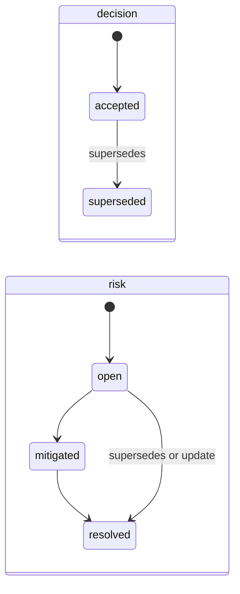

# Memory Model

agent-mem-vault keeps what an agent needs to pick up work where the last session left it, and the
decisions and risks that should keep steering later sessions. It follows the memory layers of
[CoALA](https://arxiv.org/abs/2309.02427):

| Layer | Where it lives | Lifetime |
|---|---|---|
| Working | the agent's context window | one session; not stored |
| Episodic and prospective | two companion cards per namespace: `last_session` and `threads` | overwritten every session |
| Semantic | `decision` and `risk` records with a lifecycle, `snapshot` summaries, `note`, `task`, `assumption` | until superseded, resolved or rejected |
| Procedural | your agents' instruction files and skills | outside this server |

Production incidents belong in your issue tracker, not here. Record a risk only for a lasting
constraint.

## The companion cards

Two short notes per namespace, under `<namespace-slug>/_companion/`, each capped at
`companion.max_chars` (default 3000). `update_companion` replaces a card whole.

- **last_session**: what the last session did, what is still unverified, and the next step.
  Overwrite it at the end of every session.
- **threads**: one line per open work thread, `- <branch or topic>: <status>; next: <step>`.
  Remove a line when its thread is done; pass an empty string when nothing is open. Any other line
  shape is refused.

```text
- feat/batch-backfill: batching works on a sample; next: measure the lock time on a production copy
- retry-policy: backoff values drafted; next: check them against the payment provider limits
```

With the `hooks` feature, the SessionStart hook loads both cards with the rest of the brief, and the
stop hook reminds the agent to update them once per change of the working tree.

## Decision and risk lifecycle



- A new decision is `accepted` and a new risk `open` unless a status is given. `update_memory` can
  set any state of the kind at any time; other statuses are refused for these two kinds, and every
  other kind keeps a free-text status.
- Passing `supersedes: [<id>, ...]` to `save_memory`, `update_memory` or `create_snapshot` links the
  records both ways and closes the old ones: a decision becomes `superseded`, a risk `resolved`.
- Ids can be shortened to the eight characters every listing shows.
- A record that was simply wrong is better marked `validity: rejected` with a `rejected_reason`: it
  stays on file and stops steering agents.

## The brief and consolidation

`get_project_brief` (and the SessionStart hook) returns, in order:

1. the last-session card and the threads card;
2. the latest snapshot that is not superseded, private or rejected;
3. the active records created after that snapshot: kind, status, title and id, so a mitigated risk
   reads `[risk: mitigated]` and an open one `[risk: open]`;
4. `Consolidation due: <reason>` when that snapshot is older than seven days, or when there is no
   snapshot but there are active records.

When the brief says consolidation is due, the agent folds the records listed since the snapshot into
a new `create_snapshot(..., supersedes=[<old snapshot id>])`, supersedes or resolves the records that
no longer hold, and moves on without asking. With `features.git_autocommit` every one of those writes
is its own commit in the vault repository, so any of it can be reverted.

## Several agents, several machines

- Claude Code and Codex read and write the same namespace. Without a `namespace` argument a call uses
  `project/<git root name>` of the directory the server runs in, so both agents land in the same place.
- Writes take an exclusive file lock and replace files atomically, so two agents writing at once never
  lose a write. A lock held for more than five seconds is a clear error.
- To continue on another machine, push a wip branch and keep its line in the threads card; with the
  vault in a git repository synced between the machines, the next session there starts from the same
  brief.

## Telling your agents

Add a line to each agent's instructions, for example: "At the start of work read the brief from
`get_project_brief`. Before stopping, rewrite `last_session` and update `threads` with
`update_companion`, and record a decision or risk with `save_memory` only when one was made or
verified. When the brief says `Consolidation due`, consolidate."

## Upgrading from 1.x

1.x handoffs are no longer read. Archive them once with `agent-mem-vault migrate --dry-run` and then
`agent-mem-vault migrate --apply`; see the
[changelog](https://github.com/kursatdinc/agent-mem-vault/blob/main/CHANGELOG.md) for every step.
