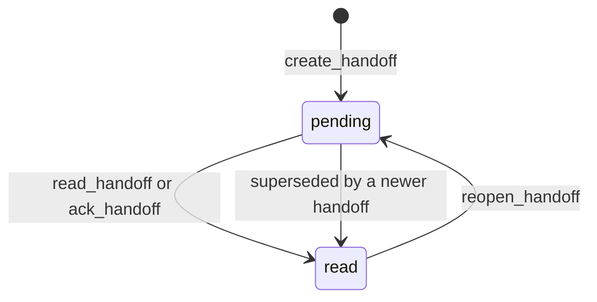

# Multi-Agent Handoffs

A handoff is a note from one agent to another about work that should continue: what happened and
what to do next. It is how a decision or a half-finished task survives a change of tool.

## Lifecycle



- **pending**: created, `read: false`. It is waiting for the destination agent.
- **read**: the agent read it (`read_handoff`) or acknowledged it (`ack_handoff`). The record gets
  `read: true` and `read_at`.
- **reopened**: `reopen_handoff` makes it pending again and removes `read_at`.
- **superseded**: a newer handoff passed this one's id in `supersedes`. The older one becomes read and
  gets `superseded_by`, so the queue holds one live thread instead of a pile.

## A typical exchange

Claude Code finishes for the day:

```text
create_handoff(
  to="codex",
  summary="Batch the orders backfill",
  context="The backfill in migrations/0007 needs batching. Start with 1000 rows and measure lock time.",
  namespace="project/harbor-api")
```

Next morning, Codex starts a session. With the `hooks` feature the brief is loaded for it, and it
checks for handoffs:

```text
read_handoff(agent="codex", namespace="project/harbor-api")
-> "## Summary\nBatch the orders backfill\n\n## Full Context\n..."
```

The handoff is now read. If the plan changes before anyone reads it, the author sends a new one that
replaces it:

```text
create_handoff(to="codex", summary="...", context="...",
               namespace="project/harbor-api", supersedes=["<id of the first handoff>"])
```

## Choosing the right tool

| Want to | Use |
|---|---|
| Take the next handoff and mark it read | `read_handoff` |
| Look without consuming it | `peek_handoff` |
| See what is waiting, or what was sent | `list_handoffs` with `status` and `agent` |
| Close one that was handled elsewhere | `ack_handoff` |
| Bring one back | `reopen_handoff` |

`read_handoff` returns the newest pending handoff for the agent in that namespace.

## Agent names

An agent name is just a string, matched exactly. Pick stable ones, such as `claude-code` and `codex`,
and use them the same way in every instruction file and hook. A handoff to `Codex` is not seen by
`codex`.

## Two agents at once

Writes take an exclusive file lock on the vault and each file is replaced atomically, so two agents
writing at the same time never interleave or lose a write. If the lock is held for more than five
seconds the caller gets a clear error.

## Seeing it in Obsidian

Pending handoffs are the first view of the generated dashboard, `_dashboards/memory.base`. From
the command line:

```sh
agent-mem-vault handoffs --namespace project/harbor-api --status pending
```

## Telling your agents

Add a line to each agent's instructions, for example: "At the start of work call
`get_project_brief` and `read_handoff` for this repository's namespace; before stopping, record
decisions with `save_memory` and leave a handoff with `create_handoff` if work should continue."
